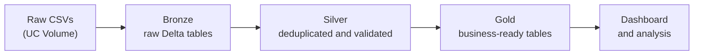

# E-Commerce Sales Analytics: PySpark ETL on Databricks

An end-to-end data project: raw e-commerce CSVs are cleaned and modelled with **PySpark** and **Spark SQL**, stored as **Bronze / Silver / Gold Delta tables** in Unity Catalog, analysed in four phases, and surfaced in a **Databricks dashboard** with business observations and recommendations.

> **Dataset note:** The data is synthetic (generated for learning), so some patterns, such as a 99.4% customer conversion rate, are unrealistically clean. The focus of this project is the engineering and analysis approach, not real-world business conclusions. All amounts are in **Indian Rupees (INR)**. 1 L (lakh) = ₹1,00,000 and 1 Cr (crore) = ₹1,00,00,000.

---

## Dashboard Preview

Built on the Gold-layer tables.

**Headline KPIs (paid orders, Jan 2022 to Jan 2026)**

<table>
  <tr>
    <td></td>
    <td></td>
    <td></td>
  </tr>
</table>

**Yearly revenue**: growth is real but slowing (2026 is a partial year, January only).

**Revenue by state**

**Top 10 products by revenue**

**Top 20 customers by spending**

---

## Data

Four raw CSVs loaded from a Unity Catalog volume:

| File | Contents | Rows | Key columns |
|---|---|---:|---|
| `customers.csv` | One row per customer | 2,015 *(2,000 unique)* | customer_id, customer_name, city, state, country, signup_date |
| `orders.csv` | One row per order | 10,000 | order_id, customer_id, order_date, payment_method, order_status |
| `order_items.csv` | One row per product per order | 21,968 | order_id, product_id, quantity, unit_price |
| `products.csv` | One row per product | 100 | product_id, product_name, category, price |

**Coverage:** customer signups from Jan 2022 to Jun 2024; orders from Jan 2022 to Jan 2026; all customers in India; 7 product categories; 5 payment methods.

---

## Pipeline

1. **Load** the CSVs into Spark DataFrames and verify schemas.
2. **Audit** for duplicates: 15 duplicate customer rows found and removed in Silver (kept in Bronze for audit).
3. **Aggregate** order items to one total per order.
4. **Join** all four tables through Spark SQL temp views.
5. **Analyse** in four phases (below).
6. **Persist** results as 13 Delta tables.

**Business rules**
- Only **Shipped, Processing and Completed** orders count as revenue. Cancelled and Returned orders are excluded.
- Yearly tables are capped at 2025 because only January 2026 data exists. The dashboard KPI tiles include those January 2026 orders (about ₹0.30 Cr), so the headline ₹9.47 Cr is slightly higher than the ₹9.17 Cr shown for 2022 to 2025.

---

## Analysis Phases

| Phase | Focus | Question |
|---|---|---|
| **1. Sales** | Monthly and yearly revenue, AOV, order status, payment methods | How are orders and revenue trending? |
| **2. Products** | Top 10 products, category ranking with `rank()` window function | Which products and categories drive revenue? |
| **3. Customers** | Top spenders, revenue by state and city | Who are the best customers and where are they? |
| **4. Advanced** | Cancellation and return losses, signup cohorts and conversion | How much revenue leaks, and do cohorts convert? |

---

## Key Results

| Year | Paid orders | Revenue | Avg. order value | YoY revenue growth |
|---|---:|---:|---:|---:|
| 2022 | 440 | ₹0.43 Cr | ₹9.7K | n/a |
| 2023 | 1,564 | ₹1.59 Cr | ₹10.2K | +270% |
| 2024 | 3,162 | ₹3.25 Cr | ₹10.3K | +104% |
| 2025 | 3,363 | ₹3.90 Cr | ₹11.6K | +20% |

| Metric | Value |
|---|---|
| Total revenue (paid orders) | ₹9.47 Cr |
| Total paid orders | 8.8K |
| Average order value | ₹10.76K |
| Electronics revenue | ₹6.36 Cr (about 67% of product revenue) |
| Top payment method | UPI: 3,823 orders (about 44%), ₹4.07 Cr |
| Lost to cancellations and returns | ₹1.24 Cr (690 cancelled = ₹75 L, 507 returned = ₹49 L) |
| Top state | Gujarat: ₹1.11 Cr |
| Customer conversion | 1,987 of 2,000 (99.4%, a synthetic-data artefact) |

---

## Observations

Figures marked "about" or "~" are read from the dashboard charts.

1. **Growth is slowing.** Revenue growth fell from +270% (2023) to +104% (2024) to +20% (2025). The 2025 increase came mostly from bigger baskets (AOV +13%) rather than more orders (+6%), so volume growth has nearly stalled. The ~9x growth from 2022 to 2025 starts from a very small base (440 orders in 2022).
2. **Revenue is concentrated in electronics and a single product.** Electronics is about 67% of product revenue; the next category, Clothing, is only ₹0.98 Cr. The Ultra-Slim 14-inch Laptop alone brings in roughly ₹2 Cr, about one-fifth of total revenue and more than double the #2 product (Smartphone Pro Max, ~₹0.9 Cr). The top 3 products make up ~40% of revenue.
3. **Cancellations are the bigger leak.** About 12% of all orders (1,197 of 10,000) are cancelled or returned, worth ₹1.24 Cr. Cancellations (₹75 L) cost more than returns (₹49 L).
4. **Geography is spread out, with gaps.** Gujarat leads (~12% of revenue), followed by Uttar Pradesh, Maharashtra, Punjab and West Bengal; the top 5 states hold roughly half of revenue. Delhi is the lowest-ranked state (~₹24 L), and Telangana, Karnataka and Tamil Nadu sit in the lower half despite being large markets.
5. **Top customers buy rarely but expensively.** The top 20 spend in a tight ₹3.3 to ₹4.3 L band, so there is no single "whale" dependency. Several of them place few, very large orders (for example 4 orders averaging about ₹1.07 L), while a 10-order customer averages about ₹37K per order. Spend is driven by ticket size, not purchase frequency.
6. **UPI is the default payment method** (about 44% of paid orders).

---

## Recommendations

Hypotheses to validate, given the synthetic data. Each ties to an observation above.

| # | Recommendation | Based on | Suggested next step |
|---|---|---|---|
| 1 | **Attack cancellations first.** Find where they concentrate before acting. | Cancellations cost ₹75 L, more than returns | Break down cancellation rate by payment method, category and state. Recovering even 25% of cancelled value is worth about ₹19 L. |
| 2 | **Reduce single-product dependency.** Keep the laptop in stock and protect its supply chain, while growing other categories. | One SKU is ~20% of revenue; electronics is 67% | Track stock-outs and margin on the top 3 products; set category growth targets. |
| 3 | **Cross-sell accessories to big-ticket buyers.** Bundle headphones, SSDs and cameras (already top-10 sellers) with laptop and phone purchases. | Top customers buy few, expensive items; accessories already sell well | A/B test bundles at checkout and measure AOV and attach rate. |
| 4 | **Shift growth from price to volume.** Run acquisition and repeat-purchase campaigns, starting with under-indexed states. | 2025 growth was mostly AOV (+13%) vs orders (+6%); Delhi, Karnataka and Tamil Nadu rank low | Pilot regional campaigns in 2 to 3 low-ranked states and compare order growth to a control. |
| 5 | **Build a loyalty path for high-value customers.** Use post-purchase offers (warranty, upgrades, accessories) since purchase frequency is low. | High spend, low frequency among top customers | Define a lifetime-spend tier (for example ₹3 L+) and track repeat rate. |
| 6 | **Keep UPI frictionless.** Ensure UPI reliability, and consider UPI-specific offers. | About 44% of orders use UPI | Monitor UPI failure and cancellation rates. |
---

## Data Quality Notes

| Issue | Impact | Status |
|---|---|---|
| 15 duplicate customer rows (2,015 rows, 2,000 unique IDs) | Would inflate customer counts | Flagged in Bronze, removed in Silver |
| Order items referencing products missing from `products.csv` | About ₹4 L of revenue has a NULL category | Documented, not yet resolved |
| 52 orders with NULL payment method | About ₹5 L of revenue | Documented, not yet resolved |
| Jan 2026 is a partial period | Distorts the last year in charts | Excluded from yearly tables; included in dashboard KPIs |

---
## Tech Stack

- **Databricks (Serverless)** for notebooks and the dashboard
- **PySpark DataFrame API**: `filter`, `groupBy`, `agg`, `countDistinct`, `when`, `withColumn`
- **Spark SQL**: temp views for joins and cohort analysis
- **Window functions**: `rank()` for category ranking
- **Unity Catalog Volumes** for raw file storage
- **Delta Lake**: Bronze, Silver and Gold medallion layers

---

## Delta Tables

| Layer | Tables | Purpose |
|---|---|---|
| Bronze | `bronze_customers`, `bronze_orders`, `bronze_order_items`, `bronze_products` | Raw data as received (duplicates kept for audit) |
| Silver | `silver_customers`, `silver_orders`, `silver_order_items`, `silver_products` | Deduplicated and validated (2,000 customers) |
| Gold | `gold_monthly_revenue`, `gold_yearly_revenue`, `gold_top_products`, `gold_customer_spend`, `gold_state_sales` | Business-ready tables powering the dashboard |

---

## How to Run

1. Upload the CSVs from `data/` to a Unity Catalog volume at `/Volumes/workspace/default/tutorial_learning/raw/`.
2. Open `Ecommerce_PySpark_ETL_Project.ipynb` in Databricks and attach **Serverless** compute.
3. Run all cells top to bottom. Phase 5 writes 13 Delta tables to `workspace.default`, so you need `CREATE` permission on that schema.
4. Build the dashboard on the Gold tables.

---

## 👋 About This Project

I built this as a hands-on PySpark and Spark SQL learning project on Databricks. It covers the full journey — from raw CSVs to clean data, business analysis, and a proper medallion architecture in Delta Lake. Everything runs on Serverless, so there's no cluster to manage.
